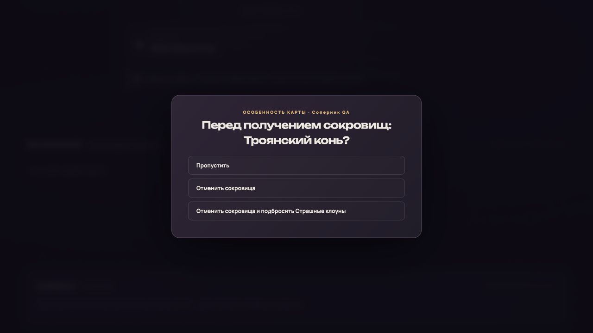
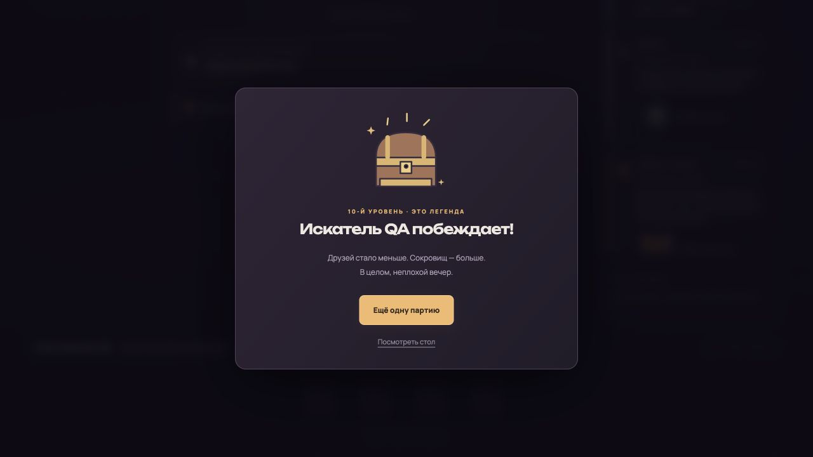

# Завершение состава и индивидуальных механик «Дикого топора»

28.10.2026. В игре 102/102 названий, 108/108 экземпляров: 64 двери + 44 сокровища. Пустые карты учтены отдельно и не раздаются. Всего в проекте 506 определений / 486 уникальных английских названий / 542 физических экземпляра; наборы по умолчанию дают 257 определений / 293 экземпляра.

## Автоматическая проверка

`npm test`: 228/228. Новые проверки — `axe-complete.test.mjs` и `axe-simulation.test.mjs`, ранее добавленные `axe.test.mjs` и `axe-equipment.test.mjs` сохранены.

Проверены:

- Добавление монстра в свой и чужой бой, в том числе превращение не-нежити усилителем Undead для присоединения к нежити; Lust Monster оставляет возможность позвать помощника другого пола до смывки.
- Печатный состав, количества, два типа колод, отсутствие пустых заглушек; монстры имеют индивидуальные непотребства, проклятия имеют именованные обработчики.
- Расовые/классовые и половые бонусы, четыре руки, потеря дополнительных рук, ограничения больших вещей, осадная машина с сохраняемым решением и штрафом смывки.
- Полный цикл бумеранга-кинжала: продажа, проклятие, воровство, возврат без дублирования, окончательная потеря от непотребства.
- Защитная шапочка, проклятие ног, блокировка проклятой вещи и её способностей, переживание непотребства, кольцо и уничтожение другим проклятием.
- B.O., Necrophobia, Fools Gold, Generosity; New Edition с личной/общей отменой и восстановлением уже применённой потери. Решение не раскрывает чужие кольца из руки.
- Brood, Sleeping, Undead, Dead Broke, исключение Humongous Fungus; Mommy как отдельный монстр, копирование усилителей без Baby.
- Friendly: решение бойца, два броска, несовместимость со сном. Dead, Disbelief, Cowardice: разные последствия без подмены обычной победой.
- Окно Trojan Horse до сокровищ, сохранение уровней, повторный бой, запрет после победного уровня.
- Annihilation: удаление из партии, возврат второго участника пары Wandering Monster/монстр, снятие бонусов зелий и прикреплённых усилителей, отсутствие второй двери после удаления открытого монстра.
- Garage Sale по цене каждой вещи, обмен руки с выбором двух колод и сохранением, связанный усилитель вещи, Itching Powder, защита от вора.
- Союзная рука, раздавливание микроба, выбор одной расы, альтернативы непотребств, скунс, Санта, двойной огонь против великана, добровольное сокровище Пиньяты.
- Пять полных партий с пятью ботами, разные фиксированные последовательности случайных чисел. Все дошли до победы без зависших решений и недопустимых действий. Найден и исправлен цикл смены вещи наёмника: замена теперь требует улучшения.

Два старых тестовых конструктора теперь очищают случайно выданные руки: наличие нового Trojan Horse у постороннего игрока больше не делает несвязанный тест выдачи наград случайным. Само окно отдельно проверяется в целевых тестах.

## Браузер

Сценарии запускались на `127.0.0.1:4387`, сохранение пользовательского `localhost:4387` не менялось. Прежнее сохранение тестового origin восстановлено; временная страница удалена.

1. В выборе дополнений отображаются 102 карты «Дикого топора».
2. После победы герой остался 6 уровня с пустой рукой до решения соперника. Троянский конь отменил сокровища и начал бой со Страшными клоунами; полученный уровень сохранился.
3. Полностью автоматическая цепочка: решение осадной машины, победа над Potted Plant, Trojan Horse соперника, повторный выбор осадной машины, победа над Scary Clowns, итоговый 10-й уровень. Без ручного вмешательства и зависания.
4. Deck Of Too Many Things: выбраны две карты для сброса; страница перезагружена посреди добора, решение восстановлено. Получена одна дверь и одно сокровище, рука содержит две карты, обязательное окно закрылось.

## Пределы и следующий шаг

Речь о завершённых игровых определениях и индивидуальных обработчиках выбранной классической редакции. Полная сверка актуальных английских печатей остаётся отдельной: `partial` и источники сохранены в реестре. Общие ограничения клирика, отдельных кубиков способностей и разграбления тела остаются в общем бэклоге. Сетевое прохождение новых решений двумя реальными клиентами вручную не проверялось; используется существующее ограничение действий через `actorModal` и добавленный `axeChoice`.

Следующий этап — иллюстрации дополнения партиями до восьми. Новые изображения не генерировались; существующие 171 оригинал сохранены. Старое сохранение не получает дополнительных экземпляров автоматически.
