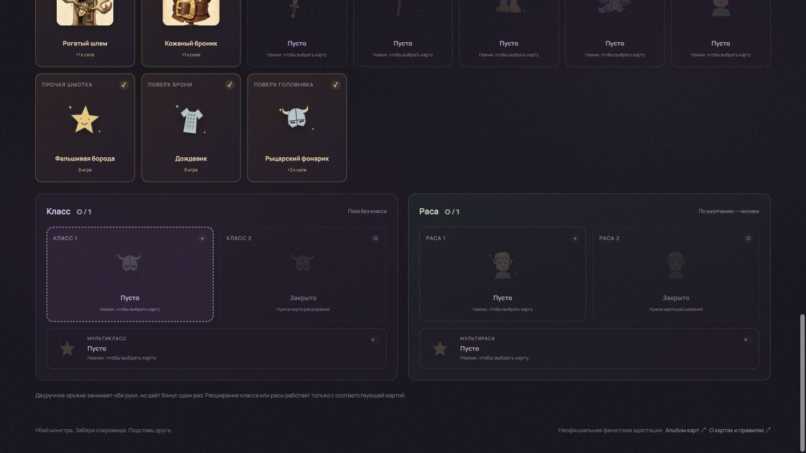
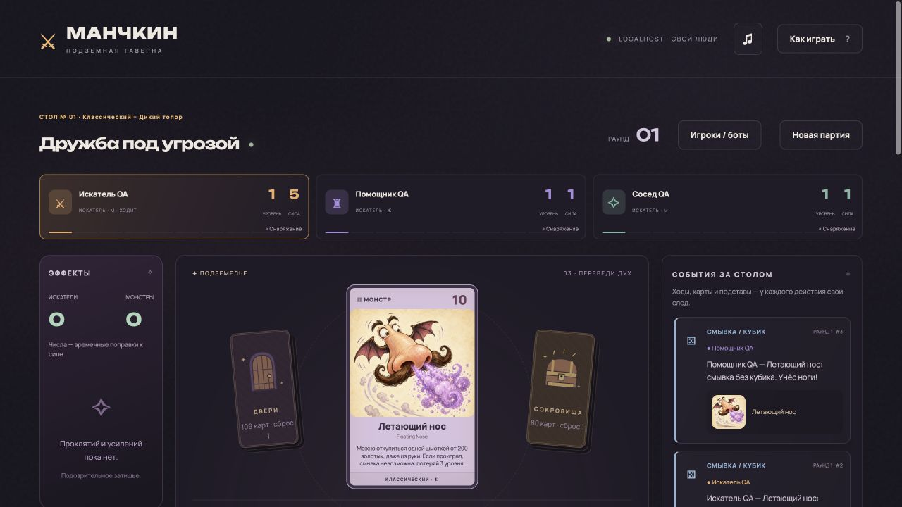

# «Дикий топор»: снаряжение и детское масло

28.10.2026. Вторая партия: Raincoat, Knight Light, Fake Beard, Baby Oil. Теперь 40/102 названий, 45/108 игровых экземпляров; ещё 62 названия отсутствуют. Новая отрисовка не проводилась. [Реестр](../rules/axe-implementation.json) и [бэклог](../../BACKLOG.md) обновлены.

## Реализовано

- **Raincoat**: броня за 100 золотых, носится поверх основной. Закрывает бой от зелий посторонних на любую сторону, включая специальные зелья передачи/превращения. Сами бойцы сохраняют право применять зелья. При потере основной брони дождевик также сбрасывается.
- **Knight Light**: +2, головняк за 400, носится поверх основного и теряется вместе с ним. В снаряжении и публичном инспекторе добавляются отдельные заполненные слоты верхнего слоя. Замена/снятие основной вещи сохраняет верхний слой; утрата от проклятия, непотребства или кражи его уничтожает.
- **Fake Beard**: 100 золотых, без слота. Разрешает дварфские вещи и вызывает соответствующие бонусы монстров. Не делает персонажа дварфом для лимита руки, больших вещей и прочих способностей. Мультираса с другой расой не отменяет реакцию монстра на бороду.
- **Baby Oil**: одноразовая вещь за 300. Гарантирует смывку от всех монстров, включая тех, от кого обычная смывка невозможна. Может спасти второго бойца с его согласием; без согласия тот смывается отдельно. Карта доступна перед броском даже при запрете обычной смывки. Гарантии переживают сохранение и очищаются после боя.
- Боты оценивают защитные вещи без боевого бонуса и не выбирают заблокированные дождевиком зелья повторно.

## Источники

Принадлежность и повторы — [список издателя](https://munchkin.game/products/games/munchkin/munchkin-2-unnatural-axe/). Тексты и параметры — прямые транскрипции Raincoat, Knight Light и Baby Oil в [игровом обсуждении](https://forum.mafiascum.net/viewtopic.php?sid=4ac6ecca575cbb05e5efa12e02393831&t=11317), Fake Beard — в [другой партии](https://forum.mafiascum.net/viewtopic.php?sid=64bac7b43c04706c5305c390d3185db7&t=12480). [Официальный FAQ](https://munchkin.game/gameplay/faq/) подтверждает возможность Raincoat поверх другой брони. Статус новых карт остаётся `partial`: фотографии актуального издания ещё не сверены. Описания игры пересказаны своими словами.

## Проверки

`npm test`: **200/200**, включая восемь новых сценариев в `tests/axe-equipment.test.mjs`:

1. Оба порядка надевания слоёв, замена основной вещи, отсутствие потерянных/повторно отображённых предметов.
2. Потеря брони и дождевика от непотребства; обычное снятие брони оставляет дождевик.
3. Проклятие головняка теряет оба слоя; воровство основного шлема сбрасывает фонарик и передаёт только шлем.
4. Raincoat блокирует обычные зелья постороннего на обе стороны и Transferral Potion, но пропускает зелья бойцов и не блокирует дверную Illusion.
5. Борода разрешает дварфское оружие, вызывает бонус 3,872 Orcs, но не меняет руку и лимит больших вещей.
6. Масло спасает обоих согласных бойцов от Floating Nose, сохраняется посреди смывки, не затрагивает постороннего игрока.
7. Отказ второго бойца оставляет ему отдельное непотребство. Масло предлагается до попытки невозможной обычной смывки; Potion of Flight по-прежнему такой возможности не получает.
8. Бот надевает дождевик и пропускает заблокированное зелье.

`cards:check`, `cards:axe:check`, `art:check` прошли. Общий каталог: 444 определения / 424 уникальных английских названия / 479 экземпляров. Наборы по умолчанию: 195 определений / 230 экземпляров. Новые карты участвуют в новой партии независимо от изображений. Старое сохранение не пополняется автоматически.

## Браузер

Сценарии проводились на отдельном `127.0.0.1:4387`. Сохранение `localhost:4387` не менялось; прежнее сохранение тестового origin восстановлено, временная страница удалена.

- Открыта подготовленная партия с двумя слоями брони и головняка: видны основная броня, шлем, дождевик и фонарик, каждая карта один раз. Борода показана в прочем снаряжении, лимит руки остался 5.
- Открыт бой с Летающим носом и помощником. Действие детского масла запросило согласие помощника. После «Да» бой завершён, в журнале для обоих записана успешная смывка без кубика, карта ушла в сброс.
- Сетевой сценарий с отдельным реальным клиентом вручную не проверялся; для согласия используется существующее окно `actorModal` и кнопки согласия.

