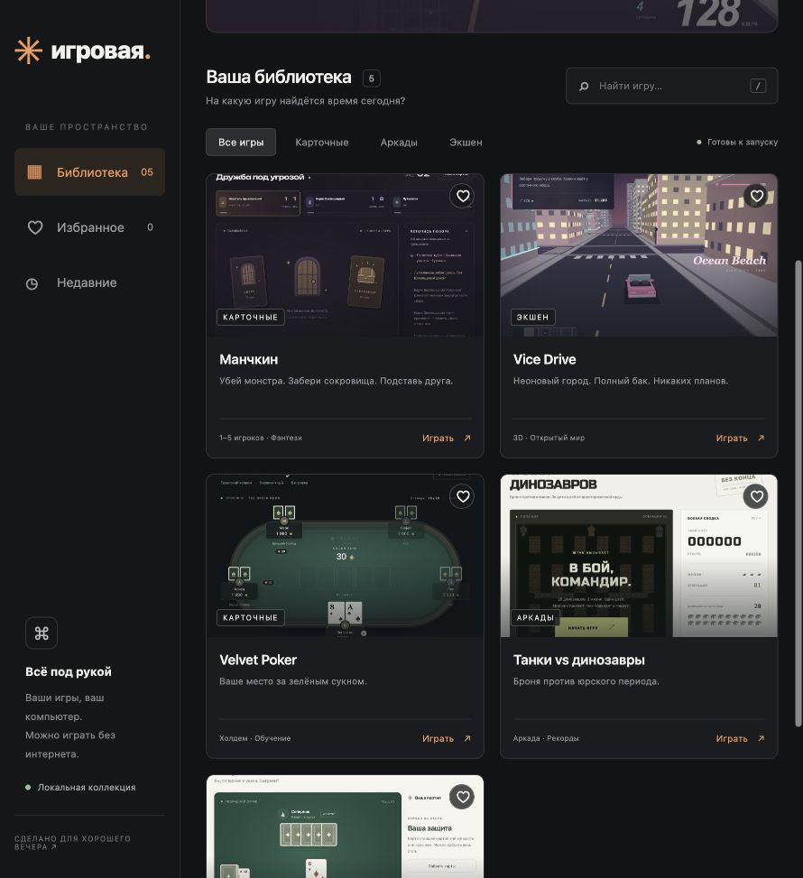

# Игровая — Game Portal

Единый локальный веб-хаб для пяти браузерных игр. Поиск, фильтры по жанрам, избранное, недавние игры, запуск внутри портала, в отдельной вкладке и на весь экран.

## Запуск

Нужен Node.js 20 или новее. Устанавливать зависимости и собирать проект не требуется.

```sh
gh repo clone realax07/game-portal
cd game-portal
npm start
```

Откройте [localhost:8080](http://localhost:8080). Сервер слушает только `127.0.0.1`. Остановка — Ctrl+C. Для другого порта: `PORT=8081 npm start`.

## Игры

| Игра | Папка | Что внутри |
| --- | --- | --- |
| Манчкин — Подземная таверна | `Manchkin/public` | Фэнтезийная карточная игра для 1–5 игроков, боты и игра за одним экраном |
| Vice Drive | `GTA/dist` | 3D-город, машины, погони и задания; нужен WebGL |
| Velvet Poker | `Poker/velvet-poker/dist` | Техасский холдем с ботами, обучение и виртуальные фишки |
| Танки против динозавров | `Tanks/tanki/dist` | Аркада с защитой штаба, бонусами и рекордами |
| Дурак | `Durak` | Подкидной дурак на 36 карт против компьютера |

Файлы `dist/` содержат сами игры и включены в репозиторий. Хаб использует их напрямую. Исходники, инструкции, имеющиеся тесты, превью и атрибуция иллюстраций сохранены в папках игр.

Избранное, недавние игры и поддерживаемые играми сохранения хранятся в браузере. Возврат в библиотеку закрывает текущую игру; восстановление партии зависит от самой игры. Сохранения с других localhost-портов автоматически не переносятся. При отсутствии интернета внешние шрифты Манчкина заменяются системными.

## Проверка

```sh
npm test
```

Запускает существующие проверки Дурака, Vice Drive, покерного движка, обучения покеру и Манчкина. У Танков отдельного автоматического набора тестов нет.

## Структура

`game-hub/server.mjs` обслуживает интерфейс, API каталога и ресурсы игр. `game-hub/public/` содержит веб-интерфейс. Список игр, пути к игровым файлам и превью задаются в массиве `games` в сервере; счётчики интерфейса вычисляются из каталога.

## Права и атрибуция

Лицензия исходного кода — [MIT](LICENSE). Манчкин — неофициальная фанатская адаптация; Munchkin принадлежит Steve Jackson Games. Vice Drive — самостоятельный прототип, вдохновлённый атмосферой Vice City. Проекты не связаны с правообладателями оригинальных игр. Сторонние иллюстрации сохраняют собственные условия: [Game-icons.net, авторы и CC BY 3.0](Manchkin/public/assets/cards/ATTRIBUTION.md). Условия MIT не заменяют права на сторонние материалы и товарные знаки.


